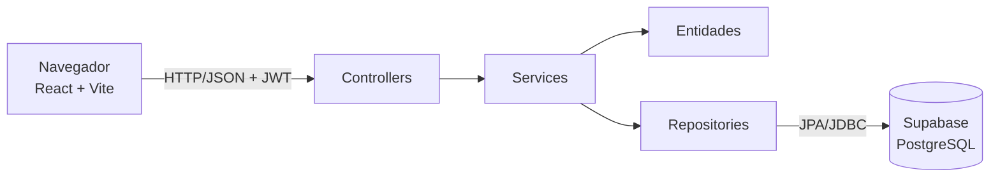

# 🚗 Sistema de Aluguel de Carros

> [!NOTE]
> Sistema web para efetuar, modificar, avaliar e cancelar pedidos de aluguel de automóveis, do pedido do cliente até a execução do contrato.

Projeto do **Laboratório 02** da disciplina de Desenvolvimento e Integração de Aplicações Web (DIAW), do curso de Engenharia de Software da PUC Minas.

---

## 🚧 Status do Projeto

    

Protótipo funcional. O banco foi testado em H2 e em um PostgreSQL local. A conexão com um projeto Supabase real depende das suas credenciais (veja [Configuração do Supabase](#-configuração-do-supabase)).

---

## 📚 Índice
- [Links Úteis](#-links-úteis)
- [Sobre o Projeto](#-sobre-o-projeto)
- [Funcionalidades Principais](#-funcionalidades-principais)
- [Tecnologias Utilizadas](#-tecnologias-utilizadas)
- [Arquitetura](#-arquitetura)
- [Instalação e Execução](#-instalação-e-execução)
- [Configuração do Supabase](#-configuração-do-supabase)
- [Deploy](#-deploy)
- [Estrutura de Pastas](#-estrutura-de-pastas)
- [Demonstração](#-demonstração)
- [Testes](#-testes)
- [Documentações utilizadas](#-documentações-utilizadas)
- [Autores](#-autores)
- [Licença](#-licença)

---

## 🔗 Links Úteis
* 📖 **Histórias de usuário:** [docs/historias-de-usuario.md](docs/historias-de-usuario.md)
* 📐 **Diagrama de casos de uso:** [docs/diagrama-de-casos-de-uso.md](docs/diagrama-de-casos-de-uso.md)
* 🧩 **Diagrama de classes:** [docs/diagrama-de-classes.md](docs/diagrama-de-classes.md)
* 📦 **Diagrama de pacotes:** [docs/diagrama-de-pacotes.md](docs/diagrama-de-pacotes.md)

---

## 📝 Sobre o Projeto

O sistema apoia a gestão de aluguéis de automóveis pela internet e só pode ser usado após cadastro e login.

- **Clientes** introduzem, consultam, modificam e cancelam pedidos.
- **Agentes** (empresas e bancos) analisam os pedidos do ponto de vista financeiro, modificam, dão parecer e executam os contratos aprovados.

Dependendo do contrato, o automóvel fica registrado em nome do cliente, da empresa ou do banco. O aluguel também pode ter um contrato de crédito, concedido por um banco agente.

---

## ✨ Funcionalidades Principais

- 🔐 **Autenticação:** login obrigatório com usuário e senha, senhas com BCrypt e sessão com JWT.
- 👤 **CRUD de cliente:** RG, CPF, nome, endereço, profissão e até 3 rendimentos, com validação de CPF.
- 📝 **Pedidos de aluguel:** criação, consulta, modificação, cancelamento e acompanhamento de status.
- 🚫 **Conflito de períodos:** um automóvel não aceita dois pedidos ativos no mesmo período.
- 🧾 **Análise financeira:** o agente vê a renda do cliente e registra um parecer positivo ou negativo.
- 📄 **Contratos:** execução de pedidos aprovados e registro do proprietário do automóvel.
- 🏦 **Contrato de crédito:** concedido somente por bancos.
- 🚙 **Frota:** cadastro de automóveis pelos agentes.

---

## 🛠 Tecnologias Utilizadas

### 💻 Front-end

* **Biblioteca:** React 19, React Router 7
* **Linguagem:** JavaScript (ES6+)
* **Estilização:** CSS puro
* **Gerenciamento de estado:** Context API
* **Build tool:** Vite 8

### 🖥️ Back-end

* **Linguagem:** Java 25 (JDK 25)
* **Framework:** Spring Boot 4.0.9 (Web MVC, Data JPA, Security, Validation)
* **Build e dependências:** Apache Maven (via Maven Wrapper)
* **Banco de dados:** Supabase (PostgreSQL), com H2 em memória para desenvolvimento local
* **ORM:** Hibernate/JPA
* **Autenticação:** Spring Security e OAuth2 Resource Server (JWT HS256)

---

## 🏗 Arquitetura

O sistema é um monólito **MVC** com front-end separado:

| Camada MVC | Onde fica | Papel |
| :--- | :--- | :--- |
| **View** | `frontend/` | Constrói as páginas dinamicamente no navegador. |
| **Controller** | `controller`, `service` | Recebe as requisições e coordena os casos de uso. |
| **Model** | `model`, `repository` | Guarda as regras do domínio e o acesso a dados. |



**Principais decisões:**

- **Padrões:** Service Layer, Repository e DTOs. As entidades nunca são expostas pela API.
- **Regras de status na entidade:** `PedidoAluguel` decide quais transições são válidas.
- **Permissões em dois níveis:** papéis em `SecurityConfig` (cliente ou agente) e propriedade dos dados nos serviços (um cliente só acessa o que é dele).
- **Agentes sem autocadastro:** ninguém pode se registrar sozinho como banco. Os agentes entram pela carga inicial do sistema.
- **Schema `aluguel` no Supabase:** tabelas no schema `public` ficam expostas pela Data API do Supabase, então usamos um schema próprio.
- **Concorrência:** trava pessimista no automóvel durante a checagem de períodos e `@Version` no pedido.

**Limitação conhecida:** o schema é gerado com `ddl-auto=update`, o que é suficiente para um protótipo. Em produção, o ideal é usar migrações versionadas, como Flyway.

### Diagramas

Os diagramas ficam em [`docs/`](docs/) e usam Mermaid, renderizado pelo GitHub. Cada arquivo tem um histórico de revisões.

---

## 🔧 Instalação e Execução

### Pré-requisitos

* **JDK 25**. O Maven não precisa ser instalado, pois o projeto traz o Maven Wrapper.
* **Node.js 24** e **npm 11** (versões usadas no desenvolvimento).

### 🔑 Variáveis de Ambiente

Só são necessárias ao usar o Supabase. O perfil `dev` funciona sem nenhuma delas.

#### 1. Back-end (`backend/.env`)

Veja o modelo em [`backend/.env.example`](backend/.env.example).

| Variável | Descrição |
| :--- | :--- |
| `SUPABASE_DB_URL` | URL JDBC do Session pooler do Supabase. |
| `SUPABASE_DB_USER` | Usuário do banco, no formato `postgres.REF_DO_PROJETO`. |
| `SUPABASE_DB_PASSWORD` | Senha do banco. |
| `APP_JWT_SECRET` | Segredo aleatório para assinar os tokens, com pelo menos 32 caracteres. |
| `APP_CORS_ORIGENS` | Origens permitidas do front-end. |
| `APP_SEED_ENABLED` | `true` cria agentes, um cliente e automóveis iniciais. |
| `APP_SEED_SENHA` | Senha das contas iniciais, obrigatória com a carga ativa. |

#### 2. Front-end (`frontend/.env`)

| Variável | Descrição |
| :--- | :--- |
| `VITE_API_URL` | URL do back-end em produção. Em desenvolvimento, deixe vazia. |

### 📦 Instalação de Dependências

O Maven Wrapper baixa as dependências do back-end na primeira execução. Para o front-end:

```bash
npm --prefix frontend install
```

### ⚡ Como Executar a Aplicação

#### Terminal 1: Back-end

Para rodar localmente com H2, sem Supabase (no Windows PowerShell):

```powershell
cd backend
.\mvnw.cmd spring-boot:run "-Dspring-boot.run.profiles=dev"
```

No Linux ou macOS:

```bash
cd backend && ./mvnw spring-boot:run -Dspring-boot.run.profiles=dev
```

Para usar o Supabase, configure `backend/.env` e rode o mesmo comando sem o perfil `dev`.

#### Terminal 2: Front-end

```bash
npm --prefix frontend run dev
```

Acesse **http://localhost:5173**.

#### Contas do perfil `dev`

Todas usam a senha `demo1234` e valem apenas para o banco local em memória.

| Usuário | Tipo | Nome |
| :--- | :--- | :--- |
| `cliente` | Cliente | Marina Duarte |
| `locadora` | Agente (empresa) | Locadora Horizonte |
| `banco` | Agente (banco) | Banco Aliança |

> [!WARNING]
> No perfil `dev`, os dados são perdidos ao encerrar o back-end.

---

## 🗄 Configuração do Supabase

1. Crie um projeto em [supabase.com](https://supabase.com).
2. Em **Connect**, copie os dados do **Session pooler**, que funciona em redes IPv4.
3. Copie `backend/.env.example` para `backend/.env` e preencha as variáveis.
4. Na primeira execução, use `APP_SEED_ENABLED=true` e defina `APP_SEED_SENHA`, para que existam agentes no sistema.
5. Inicie o back-end sem o perfil `dev`. O Hibernate cria o schema `aluguel` e as tabelas.

Para ver os dados, abra o **Table Editor** do Supabase e selecione o schema `aluguel`.

---

## 🚀 Deploy

```bash
npm --prefix frontend run build
```

Esse comando gera os arquivos estáticos em `frontend/dist`, que podem ser servidos por qualquer hospedagem estática. Defina `VITE_API_URL` antes do build.

```bash
cd backend && ./mvnw clean package && java -jar target/aluguel-carros-1.0.0.jar
```

No servidor, defina as variáveis de ambiente do back-end, incluindo a URL do front-end em `APP_CORS_ORIGENS`.

---

## 📂 Estrutura de Pastas

```
.
├── backend/
│   ├── src/main/java/br/pucminas/aluguel/
│   │   ├── config/        # Carga inicial
│   │   ├── controller/    # Endpoints REST
│   │   ├── dto/           # Entrada e saída da API
│   │   ├── exception/     # Erros de negócio e respostas HTTP
│   │   ├── model/         # Entidades e regras de domínio
│   │   ├── repository/    # Acesso a dados
│   │   ├── security/      # Regras de acesso e JWT
│   │   └── service/       # Casos de uso
│   ├── src/main/resources/ # application.properties e perfil dev
│   └── src/test/           # Testes de integração
├── docs/                   # Histórias de usuário e diagramas UML
└── frontend/
    └── src/
        ├── components/     # Formulários, cartões e modais
        ├── pages/          # Telas
        ├── api.js          # Cliente HTTP
        ├── auth.jsx        # Sessão do usuário
        └── formato.js      # Formatação de datas e valores
```

---

## 🎥 Demonstração

### 🌐 Fluxo para apresentar

1. Entre como `cliente` ou crie uma conta, e faça um pedido em **Novo pedido**.
2. Saia, entre como `banco` e use **Avaliar** para aprovar o pedido com um parecer.
3. Use **Executar contrato** e marque **Conceder contrato de crédito**.
4. Veja em **Automóveis** que o proprietário mudou.
5. Entre novamente como cliente e veja o status **Contratado** com os dados do contrato.

### 💻 Exemplo da API

```bash
curl -X POST http://localhost:8080/api/auth/login \
  -H "Content-Type: application/json" \
  -d '{"login":"locadora","senha":"demo1234"}'
```

```json
{
  "token": "<jwt>",
  "usuario": { "id": 1, "login": "locadora", "nome": "Locadora Horizonte", "tipo": "EMPRESA" }
}
```

### Endpoints

| Método | Rota | Acesso | Descrição |
| :--- | :--- | :--- | :--- |
| POST | `/api/auth/login` | Público | Login |
| GET | `/api/auth/me` | Autenticado | Usuário atual |
| POST | `/api/clientes` | Público | Cadastro de cliente |
| GET | `/api/clientes` | Agente | Lista de clientes |
| GET | `/api/clientes/{id}` | Próprio cliente ou agente | Consulta |
| PUT, DELETE | `/api/clientes/{id}` | Próprio cliente | Alteração e exclusão |
| GET | `/api/automoveis` | Autenticado | Lista de automóveis |
| POST | `/api/automoveis` | Agente | Cadastro de automóvel |
| POST | `/api/pedidos` | Cliente | Novo pedido |
| GET | `/api/pedidos`, `/api/pedidos/{id}` | Autenticado | Consulta (o cliente vê só os próprios) |
| PUT | `/api/pedidos/{id}` | Cliente dono ou agente | Modificação |
| POST | `/api/pedidos/{id}/cancelar` | Cliente dono | Cancelamento |
| POST | `/api/pedidos/{id}/avaliar` | Agente | Parecer |
| POST | `/api/pedidos/{id}/contrato` | Agente | Execução do contrato |

---

## 🧪 Testes

```bash
cd backend && ./mvnw test
```

A suíte de integração percorre os fluxos pela API: login, CRUD de cliente, permissões, períodos, avaliação, contratos e crédito. Ela roda duas vezes:

- em **H2**, o mesmo banco do perfil `dev`;
- em um **PostgreSQL embarcado**, com a mesma geração de schema usada no Supabase, para detectar diferenças de SQL.

O front-end não tem testes automatizados. Seus fluxos foram verificados manualmente no navegador.

---

## 🔗 Documentações utilizadas

* [Spring Boot](https://docs.spring.io/spring-boot/)
* [Spring Security](https://docs.spring.io/spring-security/reference/)
* [Supabase](https://supabase.com/docs)
* [React](https://react.dev/)
* [Vite](https://vite.dev/)
* [Mermaid](https://mermaid.js.org/)

---

## 👥 Autores

| Nome | GitHub |
| :--- | :--- |
| *Preencha com o seu nome* | *Preencha com o seu usuário* |

---

## 📄 Licença

Este projeto é distribuído sob a **[Licença MIT](https://github.com/joaopauloaramuni/laboratorio-de-desenvolvimento-de-software/blob/main/LICENSE)**.
