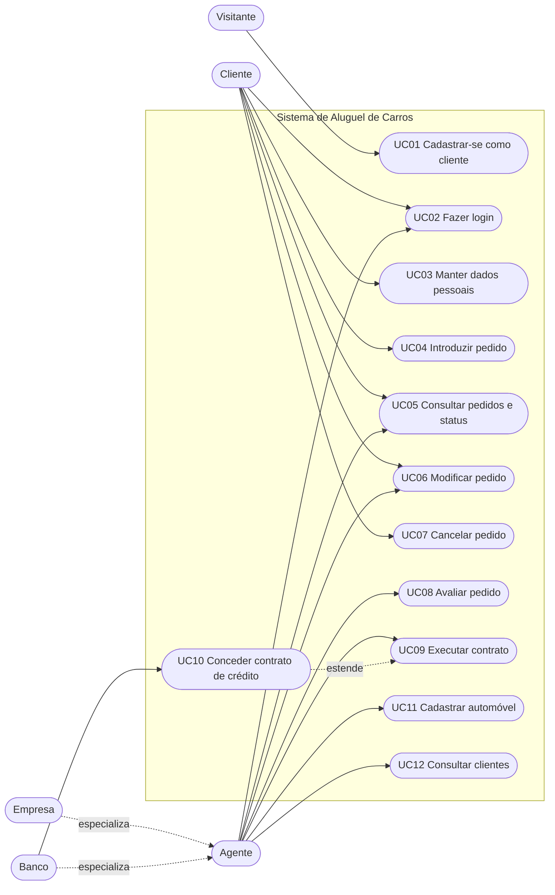

# Diagrama de Casos de Uso

O diagrama usa Mermaid, que o GitHub renderiza direto no arquivo. Atores ficam nas pontas e os casos de uso, em formato oval. **Empresa** e **Banco** são especializações de **Agente**.

## Revisões

| Versão | Alteração |
| :--- | :--- |
| 1.0 | Versão inicial, derivada do enunciado. |
| 1.1 | Inclusão de UC11 e UC12: os pedidos dependem de uma frota cadastrada, e a análise financeira depende dos dados do cliente. |
