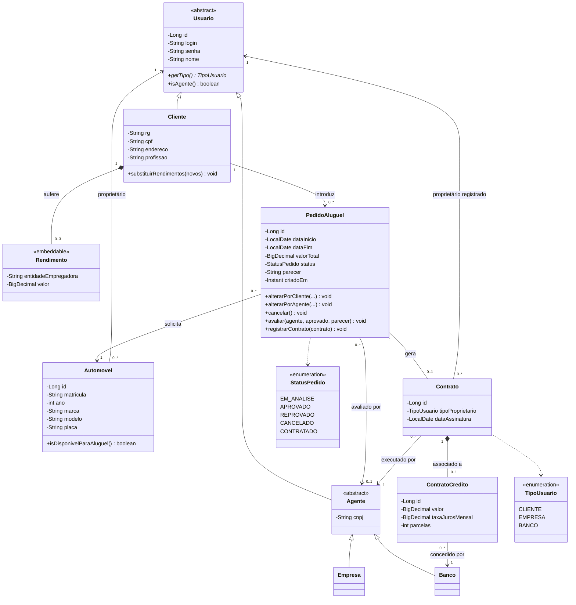
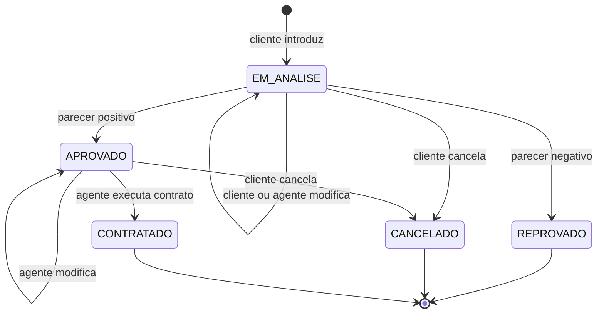

# Diagrama de Classes

Modelo de domínio, implementado no pacote `br.pucminas.aluguel.model`.

## Ciclo de vida do pedido

## Decisões de modelagem

- **`valorTotal` no pedido:** o enunciado não cita valor, mas a análise financeira precisa comparar o custo do aluguel com a renda do cliente.
- **`Rendimento` como objeto embutido:** só existe como parte de um cliente e é sempre substituído em conjunto, então não precisa de identidade própria.
- **Herança `JOINED`:** cada subclasse de `Usuario` tem sua tabela, e os dados comuns ficam em `usuarios`. Assim, `Automovel` e `Contrato` podem referenciar qualquer tipo de proprietário.
- **Regras de estado em `PedidoAluguel`:** as transições ficam na própria entidade, o que impede que um serviço deixe o pedido em um estado inválido.
- **`@Version` em `PedidoAluguel`:** se dois agentes alterarem o mesmo pedido ao mesmo tempo, o segundo recebe um aviso em vez de sobrescrever o primeiro.

## Revisões

| Versão | Alteração |
| :--- | :--- |
| 1.0 | Versão inicial, derivada do enunciado. |
| 1.1 | Inclusão de `valorTotal` e `@Version` em `PedidoAluguel`, e do diagrama de estados do pedido. |
