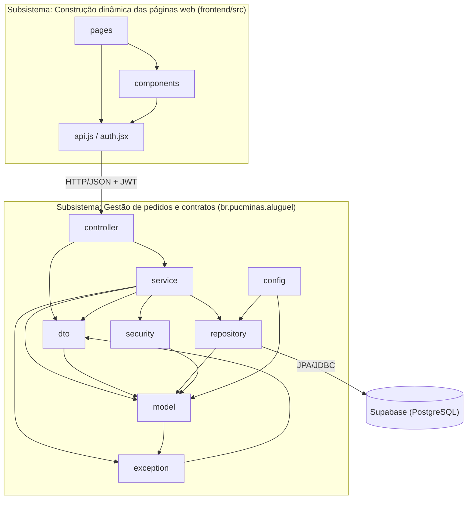

# Diagrama de Pacotes (Visão Lógica)

O enunciado divide o sistema em dois subsistemas, que se comunicam por HTTP/JSON pela internet:

- **Gestão de pedidos e contratos:** o back-end Spring Boot.
- **Construção dinâmica das páginas web:** o front-end React.

No padrão MVC, o front-end é a **View**, os pacotes `controller` e `service` fazem o papel de **Controller**, e `model` e `repository` formam o **Model**.

## Responsabilidade de cada pacote

| Pacote | Responsabilidade |
| :--- | :--- |
| `controller` | Recebe as requisições REST, valida a entrada e delega aos serviços. |
| `service` | Coordena os casos de uso, as transações e as permissões por usuário. |
| `dto` | Define os contratos de entrada e saída da API, e nunca expõe a senha. |
| `model` | Entidades JPA e regras de negócio do domínio. |
| `repository` | Acesso a dados com Spring Data JPA. |
| `security` | Filtro de segurança, regras de acesso por papel e geração de JWT. |
| `exception` | Erros de negócio e sua conversão em respostas HTTP. |
| `config` | Carga inicial de agentes e automóveis. |

## Revisões

| Versão | Alteração |
| :--- | :--- |
| 1.0 | Versão inicial, com os dois subsistemas do enunciado. |
| 1.1 | Inclusão dos pacotes `security`, `exception` e `config`, surgidos com a autenticação e o tratamento de erros. |
